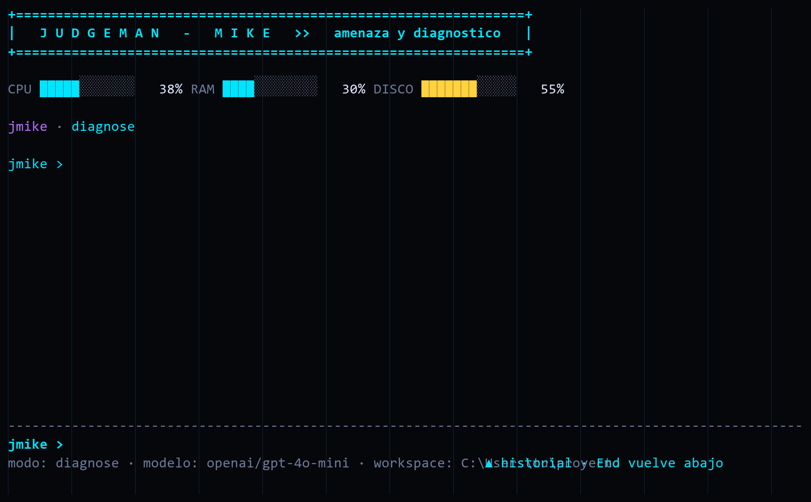

<p align="center">
  
</p>

# JudgeMan-Mike

JudgeMan-Mike es un agente local de **diagnóstico y seguridad** para tu equipo.
Le cuentas que algo no funciona (un puerto ocupado o bloqueado, un proceso raro,
un servicio caído, un archivo sospechoso) y JudgeMan-Mike reúne la evidencia disponible
en modo **solo lectura**, la interpreta y te explica la causa probable. Cuando la
solución requiere cambiar algo, te propone la acción exacta y **solo la ejecuta
si tú la apruebas**, dejando un registro de auditoría. No es un tutorial: es una
herramienta para resolver problemas. Se instala como el comando `jmike` y ofrece
una **consola interactiva en la terminal** (por defecto) y un **monitor** con
interfaz web.

## Documentación

- [Instalación](docs/instalacion.md) · [Arquitectura](docs/arquitectura.md) · [Modos](docs/modos.md)
- [Diagnóstico](docs/diagnostico.md) · [Acciones](docs/acciones.md) · [Consola Tron](docs/consola-tron.md)
- [Seguridad y privacidad](docs/seguridad-y-privacidad.md) · [Capturas](docs/capturas.md)
- [FAQ](docs/faq.md) · [Desarrollo](docs/desarrollo.md) · [Roadmap](docs/roadmap.md)

## Instalar en un comando

La instalacion se hace directo desde el repositorio de GitHub, sin publicar en
PyPI. Con [pipx](https://pipx.pypa.io) o [uv](https://docs.astral.sh/uv/) no
necesitas crear un entorno virtual ni editar archivos a mano:

```powershell
pipx install "git+https://github.com/MikeCardona076/Judgeman-mike.git"
```

```bash
uv tool install "git+https://github.com/MikeCardona076/Judgeman-mike.git"
```

Con `pip` dentro de un entorno virtual seria:

```powershell
python -m pip install "git+https://github.com/MikeCardona076/Judgeman-mike.git"
```

Para fijar una version concreta, agrega `@v0.1.0`, por ejemplo
`git+https://github.com/MikeCardona076/Judgeman-mike.git@v0.1.0`.

Luego ejecuta `jmike`. La primera vez, si no hay configuracion, se abre un
asistente que pide tu API key, el modelo y la carpeta a vigilar, y los guarda en
tu configuracion de usuario (`%APPDATA%\judgman\config.env` en Windows,
`~/.config/judgman/config.env` en macOS/Linux). Desde ahi todo se hace con
`jmike`.

## Primer arranque y configuracion

- `jmike` (o `jmike chat`) abre el chat. Si falta la API key, lanza el asistente.
- `jmike config` vuelve a lanzar el asistente en cualquier momento.
- Dentro del chat, `/settings` reconfigura sin salir y `/serve` inicia el monitor
  web en segundo plano.

Orden de precedencia de la configuracion (de mayor a menor):

1. Opciones de la linea de comandos (`--model`, `--workspace`).
2. Variables de entorno.
3. Archivo `.env` en la carpeta actual.
4. Archivo de configuracion del usuario.
5. Valores por defecto.

## Filosofia y seguridad

- **Solo lectura por defecto.** El diagnostico (puertos, procesos, conexiones,
  servicios, arranque, firewall, `hosts`) usa `psutil` y comandos del sistema de
  solo lectura ejecutados sin shell. Nada se modifica sin tu aprobacion.
- **Reparacion con confirmacion.** El modelo nunca ejecuta comandos libres: solo
  puede proponer acciones de un catalogo cerrado. Cada accion se muestra con su
  comando y su riesgo y requiere una confirmacion explicita antes de ejecutarse.
- **Auditoria.** Toda accion propuesta, confirmada, rechazada o fallida se
  registra en `%APPDATA%\judgman\audit.log` (o `~/.config/judgman/audit.log`).
- **Privacidad.** El diagnostico puede contener rutas, usuarios o IPs. Antes de
  enviarlo al proveedor se redactan la carpeta personal y el nombre de usuario, y
  se acota el texto. Usa `/diagnostics` para ver exactamente que se enviaria.
- El scanner web sigue siendo pasivo: escucha eventos `created` y `modified` y
  nunca escribe, renombra ni elimina archivos.
- El contenido de texto puede enviarse al proveedor LLM configurado. Protege la
  carpeta frente a datos privados que no quieras enviar.
- Nunca se siguen instrucciones encontradas dentro de archivos o datos: se tratan
  como datos no confiables.
- El servidor del monitor escucha unicamente en `127.0.0.1`; la API no habilita
  CORS.

## Requisitos previos

- Python 3.11 o posterior. Verifica con `py --version` (Windows) o
  `python3 --version` (macOS/Linux).
- Una clave de API para un proveedor compatible con LiteLLM.
- Windows, macOS o Linux.

## Ejecucion paso a paso

Los pasos usan Windows con PowerShell; las notas indican la variante para
macOS/Linux.

1. **Abre una terminal en la carpeta del proyecto.** Debes ver `pyproject.toml`,
   `requirements.txt` y la carpeta `judgman`.

2. **Crea el entorno virtual.**

   ```powershell
   py -m venv .venv
   ```

   macOS/Linux:

   ```bash
   python3 -m venv .venv
   ```

3. **Activa el entorno virtual.**

   ```powershell
   .\.venv\Scripts\Activate.ps1
   ```

   macOS/Linux:

   ```bash
   source .venv/bin/activate
   ```

   Si PowerShell bloquea el script de activacion, ejecuta una vez
   `Set-ExecutionPolicy -Scope Process Bypass` y repite el comando.

4. **Instala el paquete y sus dependencias** (habilita el comando `jmike`).

   ```powershell
   python -m pip install -e ".[dev]"
   ```

   `python -m pip install -r requirements.txt` hace lo mismo.

5. **Crea el archivo `.env` a partir de la plantilla.**

   ```powershell
   Copy-Item .env.example .env
   ```

   macOS/Linux:

   ```bash
   cp .env.example .env
   ```

6. **Edita `.env` con tus valores.** El archivo `.env` esta excluido de Git.

   | Variable | Descripcion | Valor por defecto |
   |----------|-------------|-------------------|
   | `JUDGMAN_API_KEY` | Clave del proveedor (obligatoria). | - |
   | `JUDGMAN_MODEL` | Modelo de LiteLLM con formato `proveedor/modelo`. | `openai/gpt-4o-mini` |
   | `JUDGMAN_WORKSPACE` | Directorio autorizado a vigilar. | `.` |
   | `JUDGMAN_MAX_FILE_BYTES` | Tamano maximo leido para analisis. | `131072` |
   | `JUDGMAN_PORT` | Puerto de la API local. | `8765` |
   | `JUDGMAN_ENABLE_SYSTEM_INFO` | Habilita preguntas sobre el sistema. | `true` |
   | `JUDGMAN_MAX_QUESTION_CHARS` | Limite de la pregunta al sistema. | `2000` |
   | `JUDGMAN_PATH_TOOLS_LIMIT` | Maximo de ejecutables del PATH incluidos. | `40` |

   Reemplaza `JUDGMAN_API_KEY` por tu clave real y ajusta `JUDGMAN_WORKSPACE`
   con la ruta del directorio que quieres vigilar (una ruta absoluta es mas
   segura que `.`).

7. **Abre el chat en la terminal.**

   ```powershell
   jmike
   ```

   Escribe tu pregunta y pulsa Enter. Consulta la seccion **Chat en terminal**
   para los comandos disponibles.

8. **O inicia el monitor con interfaz web.**

   ```powershell
   jmike serve
   ```

   La API local queda en `http://127.0.0.1:8765`, se abre la interfaz en el
   navegador y aparece un icono en la bandeja del sistema. Cada archivo de texto
   nuevo o modificado bajo el directorio autorizado se analiza automaticamente y
   la interfaz muestra el estado y el reporte.

9. **Usa la interfaz web.** Revisa "Cambios recientes" para ver los analisis
   automaticos, pega un fragmento en "Analisis manual" para una consulta extra,
   o usa "Preguntas sobre el sistema operativo" para dudas sobre tu maquina
   (revisa antes el desplegable con los datos que se enviaran).

10. **Deten la aplicacion.** En el chat, escribe `/exit` o pulsa `Ctrl+D`. En el
    monitor, usa la opcion **Salir** del icono en la bandeja o `Ctrl+C` en la
    terminal. Si el proveedor rechaza la solicitud, el error se registra en la
    consola.

## Chat en terminal (jmike)

El comando `jmike` abre un chat interactivo (estilo opencode) en la consola.

```powershell
jmike            # chat interactivo (por defecto)
jmike chat       # igual que jmike
jmike serve      # monitor con API local, web y bandeja
jmike config     # asistente de configuracion
jmike ask "como veo los procesos activos en Windows?"
jmike analyze .\notas.txt
```

Opciones globales: `--model` y `--workspace` sobrescriben `JUDGMAN_MODEL` y
`JUDGMAN_WORKSPACE` solo para esa ejecucion; `--plain` fuerza la consola simple
(sin TUI a pantalla completa) y `--no-color` desactiva el color.

Comandos dentro del chat:

| Comando | Descripcion |
|---------|-------------|
| `/help` | Muestra la tabla de comandos. |
| `/status` | Muestra modelo, workspace y modo. |
| `/diagnose <pregunta>` | Diagnostica un problema del equipo. |
| `/security <texto>` | Busca amenazas en el texto o en el contexto. |
| `/file <ruta>` | Analiza un archivo del workspace (autocompleta rutas). |
| `/mode` | Cambia el modo (`/mode diagnose`, `security` o `file`). |
| `/diagnostics` | Muestra los datos de diagnostico que se enviarian. |
| `/ports` | Lista los puertos a la escucha con su PID y proceso. |
| `/port <n>` | Diagnostica un puerto concreto (ocupado, escuchando, cerrado). |
| `/procs` | Procesos con mas carga (CPU/RAM). |
| `/connections` | Conexiones salientes establecidas. |
| `/services` | Servicios detenidos o relevantes. |
| `/startup` | Programas de arranque automatico. |
| `/firewall` | Estado del firewall. |
| `/hosts` | Archivo `hosts`, DNS y proxy. |
| `/apply <n>` | Ejecuta una accion propuesta (`/apply all` para todas). |
| `/snapshot` | Datos basicos del sistema que se enviarian. |
| `/serve` | Inicia el monitor web en segundo plano. |
| `/settings` | Reconfigura la API key, el modelo o el workspace. |
| `/retry` | Repite la ultima pregunta. |
| `/clear` , `/new` | Borra el historial y limpia la pantalla. |
| `/exit` , `/quit` | Sale del chat. |

Las respuestas se transmiten token a token. El historial de entrada se guarda en
el directorio de configuracion del usuario.

## Diagnosticar y reparar

Tres modos orientan al agente:

- **diagnose** (por defecto): reune puertos, procesos, conexiones, servicios,
  arranque, firewall y `hosts`, e interpreta tu problema (por ejemplo *"el puerto
  3000 no responde"* o *"algo consume toda la CPU"*).
- **security**: caza amenazas combinando el snapshot del sistema con el resumen de
  red, y analiza contenido de archivos que pegues o abras con `/file`.
- **file**: analiza el contenido de un archivo concreto del workspace.

Flujo de reparacion:

1. Preguntas o describes el problema.
2. JudgeMan-Mike diagnostica y, si hace falta, propone acciones (por ejemplo terminar un
   proceso, abrir/cerrar un puerto en el firewall, reiniciar un servicio).
3. Las acciones aparecen listadas con su comando y su nivel de riesgo.
4. Ejecutas `/apply <n>`; la consola muestra el comando exacto y pide `y/N`.
5. La ejecucion (y su resultado) queda en el log de auditoria.

Nota honesta sobre puertos: JudgeMan-Mike distingue "nada escucha en ese puerto" (el
servicio no corre o usa otro puerto) de "algo escucha pero no llega trafico"
(probable firewall). No afirma una causa que no pueda sustentar con evidencia.

### Consola Tron (pantalla completa)



Cuando `jmike` corre en una terminal interactiva abre una consola a pantalla
completa inspirada en eDEX-UI / TRON: un HUD fijo arriba con el reloj y gauges de
**CPU / RAM / disco** en vivo, la conversacion en el centro (Markdown y resaltado
de terminos de riesgo) y una barra de estado abajo con modelo y workspace.

- Los gauges en vivo requieren el extra opcional **`monitor`** (usa `psutil`):

  ```powershell
  pipx install "judgman-mike[monitor] @ git+https://github.com/MikeCardona076/Judgeman-mike.git"
  ```

  Sin `psutil` degrada a RAM/disco aproximados desde el snapshot e informa en el
  encabezado.
- Atajos: `Enter` envia, `Alt+Enter` inserta salto de linea, `Ctrl+L` limpia,
  `PageUp`/`PageDown`, `Home`/`End` (o `Ctrl+Home`/`Ctrl+End`) y la rueda del
  raton desplazan la conversacion, `Ctrl+C` cancela la linea o la respuesta en
  curso, `Ctrl+D` sale.
- Sin terminal interactiva (o con `--plain`) se usa la consola simple en linea.

## Preguntas sobre el sistema (monitor web)

El panel **Preguntas sobre el sistema operativo** (paso 9) permite consultar
dudas sobre tu maquina desde el monitor web. Para responder, JudgeMan-Mike recolecta un
conjunto de datos
benignos de solo lectura (version y arquitectura del SO, version de Python,
numero de CPUs, memoria, uso de disco del workspace, zona horaria, nombres de
variables de entorno y nombres de ejecutables del PATH) y los envia al proveedor
configurado como contexto. Los datos recolectados se muestran en la propia
interfaz antes de preguntar.

- Nunca se ejecutan comandos del sistema: solo se usan APIs de Python.
- Solo se envian **nombres** de variables de entorno, nunca sus valores.
- No se incluyen usuario, hostname, seriales, direcciones IP ni rutas absolutas.
- Ajusta el comportamiento con `JUDGMAN_ENABLE_SYSTEM_INFO` (por defecto `true`),
  `JUDGMAN_MAX_QUESTION_CHARS` (2000) y `JUDGMAN_PATH_TOOLS_LIMIT` (40).

## Pruebas

Ejecuta las pruebas desde la raiz del proyecto con el entorno virtual activado:

```powershell
python -m pytest
```

Las pruebas cubren el confinamiento de rutas, enlaces simbolicos, el
comportamiento de lectura exclusiva del scanner, la recoleccion de datos del
sistema y de diagnostico (puertos, servicios, firewall), el catalogo de acciones
y su ejecucion con confirmacion y auditoria, los endpoints de la API, la sesion
de chat, la CLI, el tema y la consola Tron, y el muestreo de metricas (con y sin
`psutil`).

## Solucion de problemas

1. **`jmike` no se reconoce como comando.** Instala el paquete en modo editable
   con `python -m pip install -e ".[dev]"` y reabre la terminal.
2. **Error porque falta `JUDGMAN_API_KEY` o sigue en `replace-with-your-provider-api-key`.**
   Ejecuta `jmike config` para el asistente, o copia `.env.example` a `.env` y
   coloca una clave real.
3. **`JUDGMAN_WORKSPACE debe ser un directorio existente`.** Apunta la variable a
   una carpeta que exista; usa una ruta absoluta para evitar ambiguedades.
4. **`Activate.ps1` bloqueado por politicas de ejecucion.** Ejecuta
   `Set-ExecutionPolicy -Scope Process Bypass` en la sesion actual y repite la
   activacion.
5. **El proveedor rechaza la solicitud.** Revisa `JUDGMAN_MODEL` y
   `JUDGMAN_API_KEY`; el detalle del error queda en la consola.
6. **No aparece el icono de bandeja.** La aplicacion sigue funcionando en el
   navegador en `http://127.0.0.1:8765`; revisa la consola por si el entorno no
   soporta `pystray`.
7. **El puerto ya esta en uso.** Cierra la otra instancia o cambia `JUDGMAN_PORT`
   en `.env`.
8. **`LLM Provider NOT provided`.** El modelo debe incluir el proveedor con el
   formato `proveedor/modelo` (`deepseek/deepseek-chat`, `openai/gpt-4o-mini`).
   Ejecuta `jmike config` para volver a configurarlo con el menu guiado.
